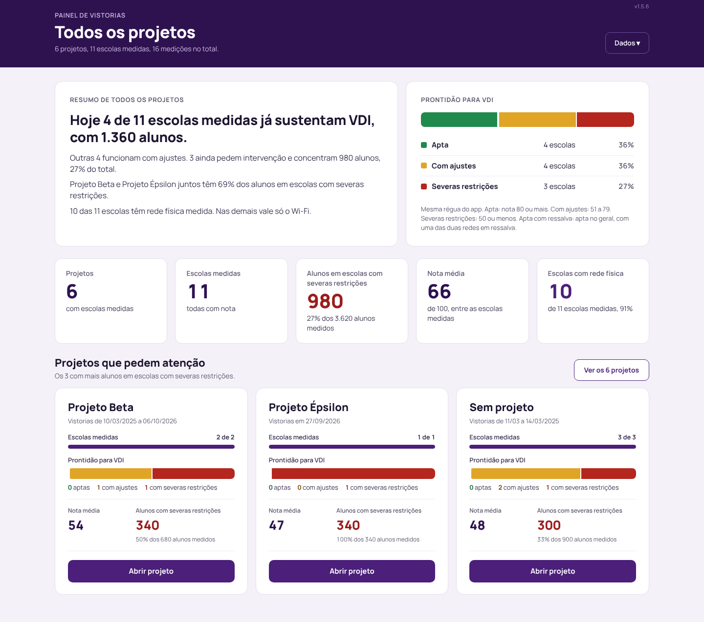
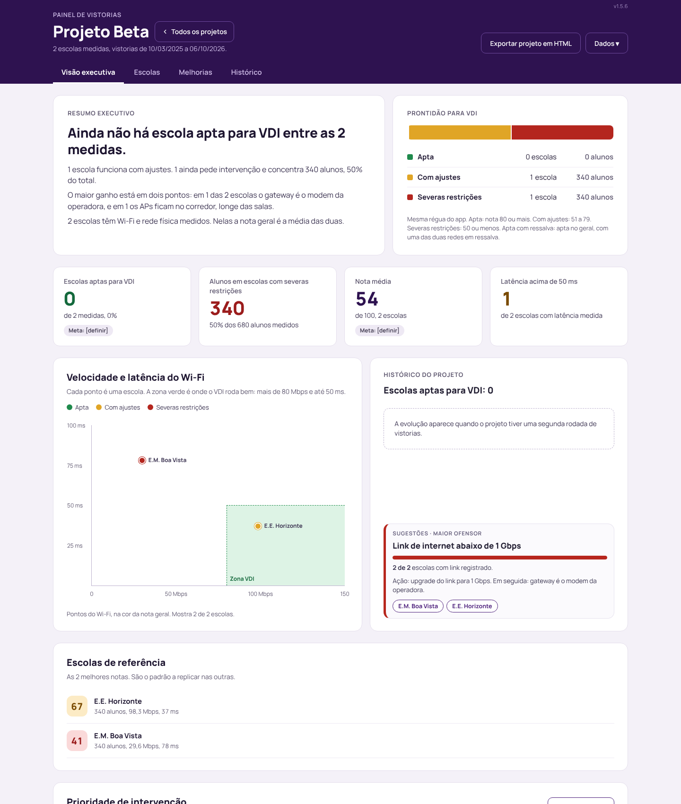
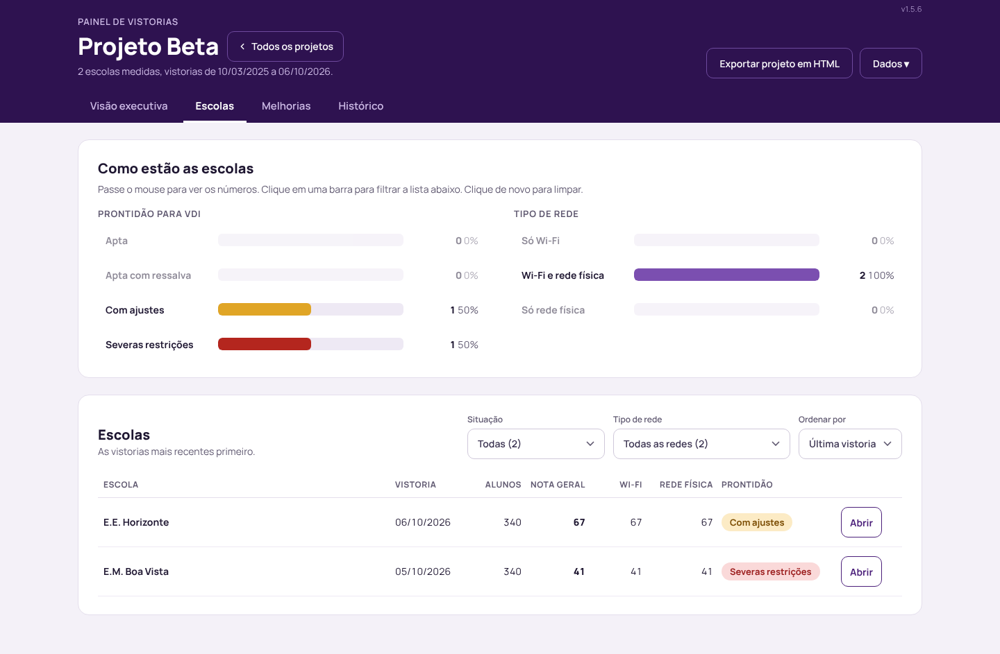
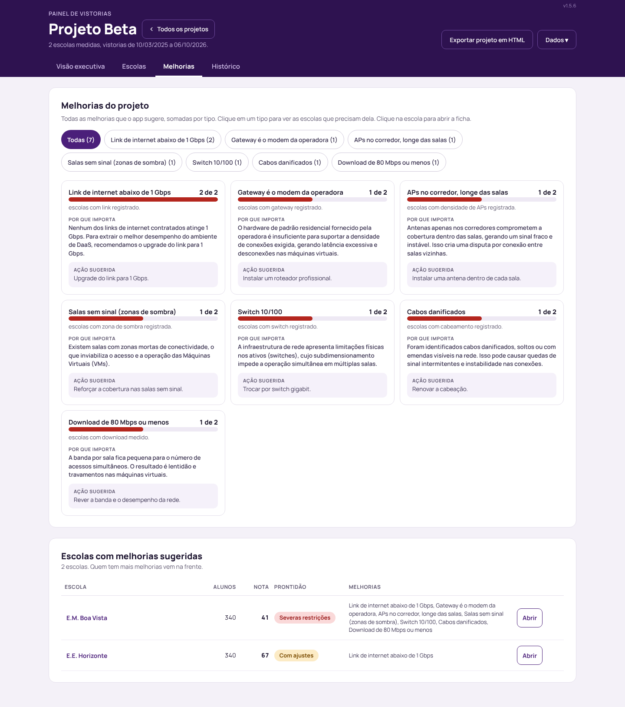
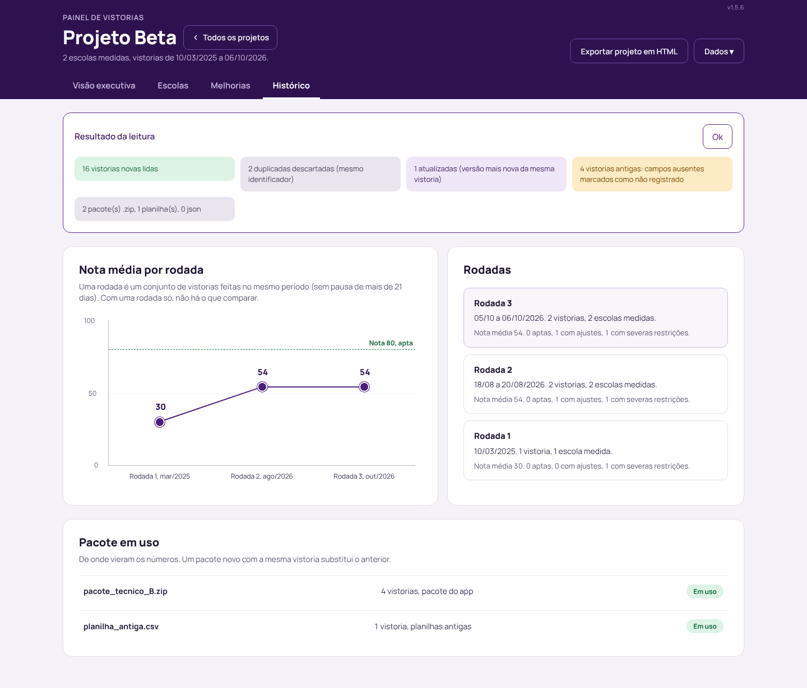
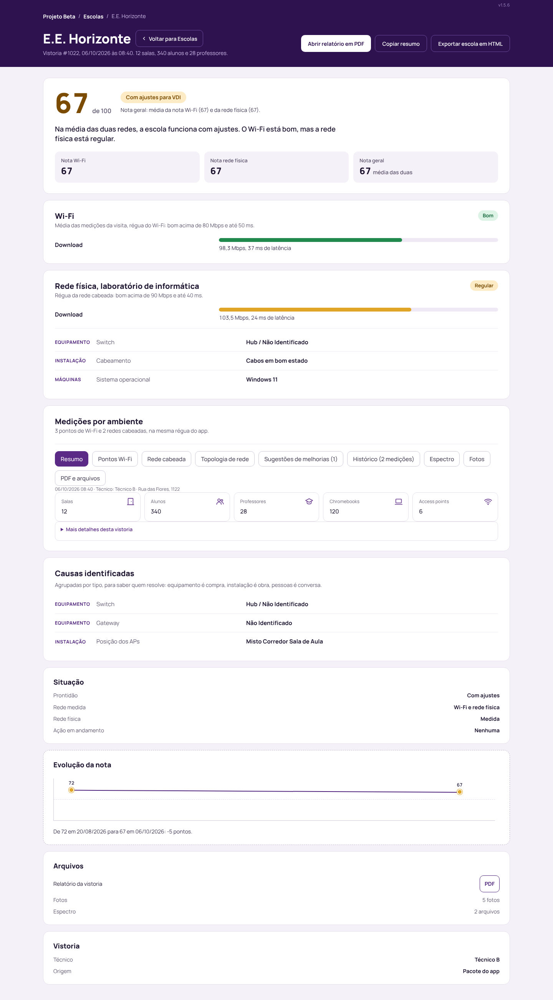
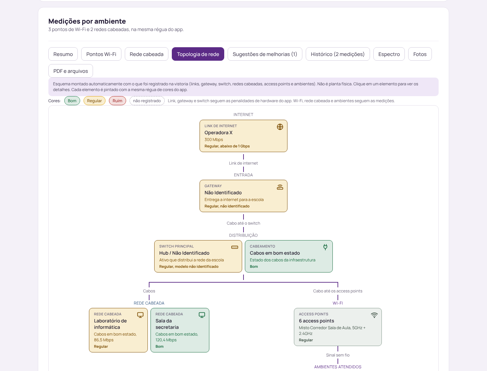

# Painel de Vistorias Arlequim

**Saber em minutos quais escolas já sustentam VDI, quais precisam de ajuste e por onde começar.**

O app de vistoria mede a rede de cada escola: Wi-Fi, rede cabeada, link, equipamentos, fotos e relatório. O Painel junta essas vistorias e responde o que a gestão precisa decidir: quantas escolas estão aptas, quantos alunos estão em escola com severas restrições, o que mais pesa em cada projeto e como a rede evoluiu.



## Por que existe

- **Uma visão para quem decide.** Cada vistoria vira número por projeto, escola a escola, com a régua do app, sem abrir relatório por relatório.
- **Zero risco com o dado.** Roda no navegador, sem servidor, sem login e sem internet. As vistorias nunca saem do computador de quem abre.
- **Nada se perde.** Vistoria antiga continua no histórico, e campo que o app antigo não media aparece como "Não registrado", nunca como zero.

## O que tem dentro

| Tela | Para quê |
|---|---|
| **Todos os projetos** | Prontidão para VDI de todos os projetos e quais pedem atenção primeiro. |
| **Visão executiva** | Resumo do projeto, indicadores, velocidade e latência por escola, maior ofensor. |
| **Escolas** | Lista filtrável por situação e tipo de rede, da vistoria mais recente para a mais antiga. |
| **Melhorias** | Sugestões do app somadas por tipo, com quantas escolas cada uma alcança. |
| **Histórico** | Rodadas de vistoria e a evolução das escolas aptas. |
| **Ficha da escola** | Nota, Wi-Fi, rede física, causas e evolução, mais o detalhe completo da vistoria: pontos de Wi-Fi, rede cabeada, topologia, espectro, fotos e PDF. |

<table>
<tr>
<td><br><sub>Visão executiva</sub></td>
<td><br><sub>Escolas</sub></td>
</tr>
<tr>
<td><br><sub>Melhorias</sub></td>
<td><br><sub>Histórico</sub></td>
</tr>
<tr>
<td><br><sub>Ficha da escola</sub></td>
<td><br><sub>Topologia montada a partir da vistoria</sub></td>
</tr>
</table>

As imagens usam os dados fictícios da pasta `amostra/`. Todas as telas estão em [`docs/telas/`](docs/telas/).

## Começar em 3 passos

1. Abrir `painel-vistorias.html` com dois cliques. No dia a dia, abrir pelo endereço fixo no OneDrive e dar F5 a cada versão nova.
2. Em **Dados**, carregar os pacotes `.zip` gerados pelo app, ou arrastar a pasta inteira. Planilhas `.csv` antigas também entram.
3. Para apresentar ou enviar: **Exportar painel em HTML**, **Exportar projeto em HTML** ou **Exportar escola em HTML**. Gera um arquivo único que abre em qualquer computador.

## Como funciona

```
pacotes do app (.zip)     ┐
planilhas antigas (.csv)  ├─▶  leitura (só lê)  ─▶  contas de gestão  ─▶  telas
HTML exportado            ┘    normalizar.js         gestao.js            views-gestao.js
                               dados.js                                   views.js (detalhe)
```

- **O painel só lê.** Não apaga, não corrige, não grava nada na vistoria.
- **A nota e a faixa são as do app.** O painel não recalcula.
- **A leitura dos dados é protegida.** `normalizar.js`, `dados.js`, `regras.js`, `pasta.js` e `scripts/compilar-antigos.js` têm a impressão digital registrada. Se um byte mudar sem autorização, o teste falha.
- **Faixas com nome único.** Apta, Apta com ressalva, Com ajustes, Severas restrições e Sem nota moram num dicionário só (`FAIXAS` em `gestao.js`). Trocar ali muda todas as telas.

Regras completas em [`docs/regras-dos-dados.md`](docs/regras-dos-dados.md).

## Para quem desenvolve

```bash
npm test          # bateria completa, sem dependência para instalar
npm run build     # gera dist/painel-vistorias.html, o arquivo único
npm run serve     # http://localhost:8080 com os mesmos cabeçalhos de segurança do site no ar
npm run amostra   # recria os dados fictícios de amostra/
```

JavaScript puro, sem framework e sem build obrigatório. Única biblioteca: JSZip, incluída em `public/assets/vendor/`.

Antes de mexer, ler [`docs/REGRAS-E-TESTES.md`](docs/REGRAS-E-TESTES.md): o que não pode mudar, a bateria obrigatória e como sair uma versão.

## Publicar

O painel está pronto para ir ao ar como site estático, mas hoje roda local. Passo a passo e proteção de acesso em [`docs/publicar.md`](docs/publicar.md). Publicar leva só a ferramenta vazia: nenhuma vistoria vai junto.

## Dados reais

Pacotes, PDFs e planilhas reais não entram no repositório. O `.gitignore` bloqueia `.zip`, `.pdf`, `.csv` e a pasta `dados/`, exceto a `amostra/` fictícia.

## Versões

O que mudou em cada entrega: [`CHANGELOG.md`](CHANGELOG.md).
